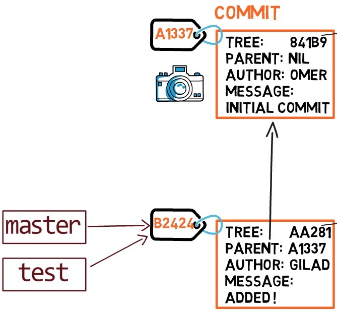
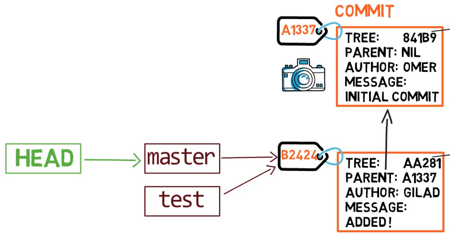
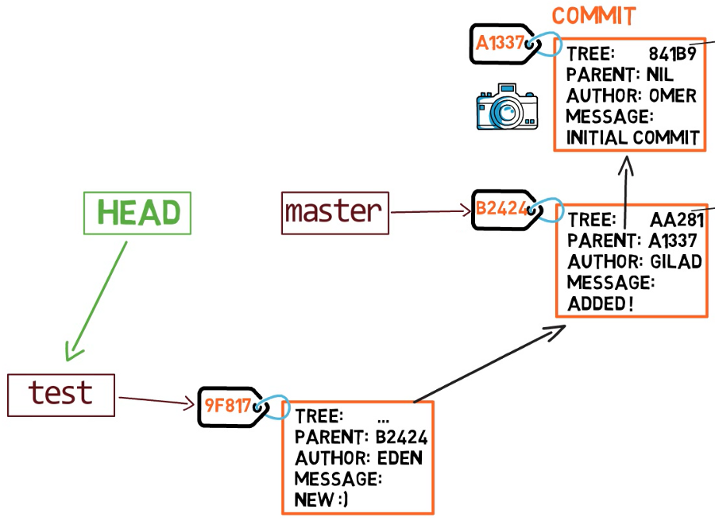
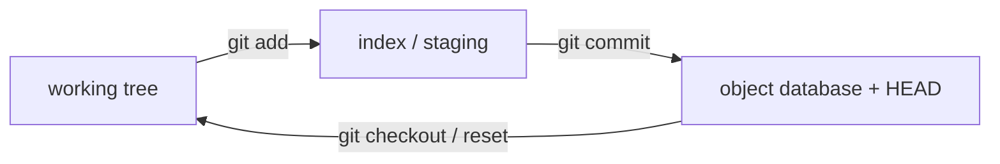

# git-practice-lab

## How git works
`Objects`: Git stores all of its data in objects, which are blobs (file content), trees (directory structures), commits (snapshots of the project at a specific point in time), and tags (labels for specific commits). These objects are identified by a unique hash based on their content.

`Commits`: A commit is a snapshot of the project at a specific point in time. Each commit contains a reference to a tree object, which represents the state of the project's directory structure, and metadata such as the author, timestamp, and a commit message. Commits are linked together in a chain, forming a history.

`Branches`: A branch is simply a lightweight movable pointer to a commit. Creating a new branch doesn't copy the entire project; it just creates a new pointer that can be moved independently of other branches. Branch names are references to specific commits.

`HEAD`: HEAD is a special pointer that points to the currently checked-out branch, which in turn points to its latest commit. It represents the commit you currently have checked out, and any changes you make will be relative to this commit.

`Index (Staging Area)`: The index is an intermediate area where changes are prepared before committing. It's a snapshot of files as they are in your working directory, but it allows you to choose which changes to include in the next commit.

`Remote Repositories`: Git allows collaboration by supporting remote repositories. Each developer can have their local repository, and changes can be pushed and pulled from remote repositories. Remote repositories are typically hosted on platforms like GitHub, GitLab, or Bitbucket.

`Branching and Merging`: Creating a branch involves creating a new pointer to the current commit. Merging combines two branches into a single branch. Git uses a three-way merge algorithm to reconcile changes.

## Git Objects:
`Blob (file content)`:
Blobs store the contents of files at a particular state. They are uniquely identified by the SHA-1 hash of their content.
`Tree (directory structure)`:
Trees represent the structure of the project at a specific point in time. They contain references to blobs (files) and other trees (subdirectories).
`Commit Object`:
A commit object contains metadata such as the author, committer, commit message, and a reference to the top-level tree that represents the state of the project at the time of the commit.

Git Branching:
Creating a Branch:

When you create a new branch, Git essentially creates a new pointer to the same commit where the branch was created. The new branch initially points to the same commit as the branch it was created from.
Switching Between Branches:

The act of switching between branches updates the HEAD pointer to point to the selected branch. Your working directory is then updated to reflect the state of that branch's latest commit.

`HEAD` references the current branch's most recent commit. HEAD functions like a pointer that continuously tracks the most recent commit in your working branch.
If we switch branches, HEAD automatically moves to the new branch and points to the most recent commit of the respective branch.
HEAD does not point to the commit directly; instead it points to the branch name where the recent commit occurred, and the branch points to the latest commit.

Git is a content-addressable filesystem. Great. What does that mean? It means that at the core of Git is a simple key-value data store. What this means is that you can insert any kind of content into a Git repository, for which Git will hand you back a unique key you can use later to retrieve that content.

`.git/objects directory (the object database)`

The subdirectory is named with the first 2 characters of the SHA-1, and the filename is the remaining 38 characters.

Blobs, on the other hand, are just contents — binary streams of data. A blob doesn’t register its creation date, its name, or anything but its contents.

In git, a snapshot is a commit. A commit object includes a pointer to the main tree (the root directory), as well as other metadata such as the committer, a commit message and the commit time. In most cases, a commit also has one or more parent commits — the previous snapshot(s).

A branch is just a named reference to a commit



So if we create a branch called test, by using git branch test, we are actually creating another pointer that points to the same commit as the branch we are currently on.

How does git know what branch we’re currently on? It keeps a special pointer called HEAD. Usually, HEAD points to a branch, which in turn points to a commit



To switch the active branch to be test, we can use the command git checkout test. Now we can already guess what this command actually does — it just changes HEAD to point to test.

In some cases, HEAD can also point to a commit directly


After a commit, the test pointer will move to the newly added commit. Note that HEAD still points to test.

Blob
- created during git add
- contains binary data for a file
- contains no metadata on the file, not even the file name

`git add` creates the blob object, and `git commit` creates a tree object and a commit object.
[Git Internals](https://www.freecodecamp.org/news/git-internals-objects-branches-create-repo/)

Remote repositories are versions of your project that are hosted on the Internet
`git remote add <shortname> <url>`

`git push <remote> <branch>` to push upstream

`git log --oneline --decorate --graph --all`

## Create a Heroku Remote
Git remotes are versions of your repository that live on other servers. You deploy your app by pushing its code to a special Heroku-hosted remote that’s associated with your app.
### For a new app
`heroku create -a example-app`
You can use the `git remote` command to confirm that a remote named `heroku` has been set for your app
### For an existing app
Add a remote to your local repository with the `heroku git:remote` command. All you need is your Heroku app’s name
`heroku git:remote -a example-app`
### Deploy changes
To deploy your app to Heroku, use the `git push` command to push the code from your local repository’s `main` branch to your `heroku` remote. For example:
`git push heroku main`

Every commit holds a single tree

`git add` creates a blob out of files
a branch is a named reference to a commit
a commit with multiple parents is a merge commit

tree inside commit
blob inside tree
every commit holds a tree, and every tree may contain any number of other trees and blobs in its leaves
the index refers to the set of newly created trees and blobs which you created by running git add, and these new objects will soon get bound into a new tree for the purpose of committing to your repo
The state of the index becomes the tree of the next commit

`origin/main` is a remote-tracking branch present in our local repository that tracks the changes made to the main branch in the remote repository

`git fetch` will fetch changes into the current repo and store them into `origin/main`

the changes are not in the current `main` yet

to merge, we use `git merge origin/main`

Instead of using a merge commit, rebasing rewrites history by creating new commits for each of the original feature branch commits. It moves the entire feature branch so that it begins at the tip of the master branch. The context is that there are changes in master that feature does not have and we want to incorporate those changes into feature.
`git switch feature` and `git rebase master`
Take the current branch I am on and base it off of master
Both help to integrate changes from one branch into another
`fast forward merge` is where the master branch has not changed but the feature branch has changed. We simply switch to master (the branch to merge into) and type `git merge feature_branch`
not all merges are fast forwards; often there is a change in both the master branch and the feature branch. This means git has to create a new merge commit on master

`git` creates the folder to reduce the number of files per folder
`tree` solves the issue of not having the file name associated with the blob

`git push REMOTE_NAME BRANCH_NAME` updates the remote branch with local commits
`git push -u origin main` sets the remote origin as the upstream reference. This allows you to later perform git push and git pull commands without having to specify an origin. `-u` or `--set-upstream`

git is a directed acyclic graph
commits all reference their parents
branches are named pointers to commits

HEAD is a special pointer to the current branch (and thus its latest commit) and automatically moves
Every commit holds the entire snapshot, not just the diffs from the previous commits
When we do `git commit`, the commit is created based on the state of the index

internally, git calls branches by the name `heads`

`HEAD` is a file whose content describes what it points to
`git write-tree` records the contents of the index in a tree object

we can use `git commit-tree <tree hash> -m <commit message>` to create a commit object that references this tree

a branch is just a file in `.git/refs/heads` that contains a hash of the commit it refers to

both remotes and heads contain files whose content are hashes of the commit they point to
`git add .` adds all files and folders to the staging area (creates the hashes)
`git commit` then creates a tree based on the contents of the staging area

The `.git/objects` directory is called the object store. It is a content-addressable data store, meaning that we can retrieve the contents of an object by providing a hash of those contents. In this way, the object store is like a database table with two columns: the object Id and the object content. The object Id is the hash of the object content and acts like a primary key

The reference store exists in the `.git/refs/` directory

In the reference store, the reference name is the primary key

An annotated tag contains a reference to another object (by object Id) and a plain-text message. The tag object references a commit object. A commit is a snapshot of the worktree at a point in time, along with connections to previous versions. It contains links to parent commits, a root tree, as well as metadata such as commit time and commit message

The commit graph is the directed graph whose vertices are the commits in the repository and where a commit has a directed edge to each of its parents


`git fetch` runs on a client repository and tries to synchronize with a remote repository. We get all objects from the remote's branches in `refs/heads/` and we write copies in `refs/remotes/<remote>`.
The first part is called ref advertisement, where the client requests the list of references available on the remote.

you can test the ref advertisement directly using the `git ls-remote --heads origin` command, which requests the ref advertisement but does not download any new objects
A commit with no parents is a root commit and a commit with multiple parents is a merge commit

we have two types of tags. A `lightweight` tag is very much like a branch that does not change — it's just a pointer to a specific commit. `Annotated tags`, however, are stored as full objects in the git database. They're checksummed; contain the tagger name, email and date; have a tagging message; and can be signed and verified with GNU Privacy Guard. It is generally recommended that you create annotated tags
By default `git push` does not transfer tags to the remote server
`git push origin <tagname>`
`git push origin --tags` will transfer all tags to the remote server
When you clone someone else's repository, it basically just copies the contents of this directory to your computer

`git diff` compares what is in the working directory and the staging area
`git diff --staged` compares the staged area to the repo
`git checkout` specifies a commit and updates your working dir to reflect that commit

`git reset --hard HEAD` throws away everything that is not committed and goes back to the latest version of what you are working on (HEAD -> branch -> latest commit)
.git is the repo

With a `git commit` command, git takes two steps:
- it creates a root tree of the repo
- it creates the commit
A root tree stores the structure of files and folders of the entire repository. It is a file containing the reference to every blob or sub-folder included in the repository, built in a recursive manner.

Each row of the root tree references a blob or other sub-trees, which in turn reference other blobs or other sub-trees in the same way. Hence, the tree is the equivalent of a directory

Tags are references to specific commits

HEAD performs a few tasks in Git:

It’s how Git knows which commit is checked out, so when we do a git branch, Git looks at HEAD to know which branch we are on.
It references the parent of the next commit, so the commit that HEAD points to will be the parent of the next commit. Recall that when we perform a commit, the parent commit is stored in the commit file.
HEAD does not point to a commit directly, but rather to a branch which in turn points to the latest commit on that branch.

Merge allows joining two or more commits. There are two types of merge:

The first kind occurs when the two branches diverged. Git creates a new child which has two parents. The first parent is the branch we are on, while the second parent is the branch that is going to be merged. The commit file will have two parents, and HEAD is moved to the new child node.
The second kind occurs when the two branches did not diverge, but indeed one branch is the continuation of the other one. In this case, the merge is called a fast-forward merge, and it is not a real merge because there are no conflicts. In this case, Git just moves HEAD and the current branch to the same commit pointed to by the to-be-merged branch.

## Sync changes from the upstream repo

To sync an upstream repo, first, you need to fetch the upstream changes
`git fetch upstream`

Then merge the changes from the upstream branch to the local branch. In this example, it's the main upstream branch
`git merge upstream/main`

When you push a local branch with the upstream command, it automatically creates the remote branch and adds tracking to your local branch
`git push origin foo` will create the remote branch without tracking, meaning when someone pushes any changes to the branch foo in the remote and you later try to pull the changes, it will throw an error
`There is no tracking information for the current branch`

You can also add git upstream using git HEAD

`git push -u origin HEAD` ; HEAD refers to the currently active branch
upstream enables local branches to track the remote branches, hence makes pulling changes from remote repos easy

pushing to HEAD is equivalent to pushing to a remote branch having the same name as your current branch.

`git push -u origin HEAD`

`git config --global alias.pushd "push -u origin HEAD"` for an alias

`git checkout --track origin/dev`
in order to switch to the local “dev” branch, and to set “origin/dev” as the tracking branch (or upstream branch)

## Why are upstream branches so useful in Git?
Upstream branches are useful because:

- You get references to your remote repositories and you essentially know if you are ahead of them or not.
When performing a “git fetch” command, you can bring the new commits from your remote repository and you can choose to merge them at will.

- You can perform pull and push easily.
When you set your upstream (or tracking) branches, you can simply execute pulls and pushes without having to specify the target branch


`diffs` are dynamically generated from the snapshot data by comparing the root trees of the commit and its parent. Git can compare any two snapshots in time, not just adjacent commits.

If commits aren’t diffs, then what does git cherry-pick do?
The `git cherry-pick <oid>` command creates a new commit with an identical diff to `<oid>` whose parent is the current commit. Git is essentially following these steps:

- Compute the diff between the commit `<oid>` and its parent.
- Apply that diff to the current HEAD.
- Create a new commit whose root tree matches the new working directory and whose parent is the commit at HEAD.
- Move the ref at HEAD to that new commit.

It is important to recognize that we didn’t “move” the commit to be on top of our current HEAD, we created a new commit whose diff matches the old commit.

If commits aren’t diffs, then what does git rebase do?
The `git rebase` command presents itself as a way to move commits to have a new history. In its most basic form it is really just a series of `git cherry-pick` commands, replaying diffs on top of a different commit

`git clone http://server/simplegit-progit.git`

`git ls-files --stage` shows you the contents of the index:
```bash
100644 1ff0c423042b46cb1d617b81efb715defbe8054d 0   .gitattributes
100644 3c4efe206bd0e7230ad0ae8396a3c883c8207906 0   .gitignore
100644 f18cc2fac0bc0e4aa9c5e8655ed63fa33563ab1d 0    MSDNConsoleApp.sln
100644 88fa4027bda397de6bf19f0940e5dd6026c877f9 0    MSDNConsoleApp/App.config
100644 d837dc8996b727d6f6d2c4e788dc9857b840148a 0    MSDNConsoleApp/MSDNConsoleApp.csproj
100644 27e0d58c613432852eab6b9e693d67e5c6d7aba7 0    MSDNConsoleApp/Program.cs
100644 785cfad3244d5e16842f4cf8313c8a75e64adc38 0    MSDNConsoleApp/Properties/AssemblyInfo.cs
```

[Branching-Remote-Branches](https://git-scm.com/book/en/v2/Git-Branching-Remote-Branches)

[commits-are-snapshots-not-diffs](https://github.blog/2020-12-17-commits-are-snapshots-not-diffs/)


[index](https://github.blog/2021-11-10-make-your-monorepo-feel-small-with-gits-sparse-index/)

[index](https://mincong.io/2018/04/28/git-index/)

[Git Internals](https://www.youtube.com/watch?v=P6jD966jzlk)

Git stores whole `snapshots`, not diffs. Everything it remembers is one of four `objects` — a `blob` (file bytes), a `tree` (a directory listing), a `commit` (one tree + parent(s) + metadata), and an annotated `tag` — each named by the `hash of its own contents`. That `content-addressing` is what gives git deduplication, integrity, and its history shape: because a commit embeds its parent's hash, history is an immutable `DAG`. On top of that frozen object graph sits a thin mutable layer of `refs` — a `branch` is literally a small file holding one commit hash, and `HEAD` is the pointer saying "where am I."

`That split is the entire worktree feature`. A worktree gives you an additional `working tree + index + HEAD` bolted onto the same shared object database and branches. A linked worktree gets a `.git` file (not folder) pointing into `.git/worktrees/<name>/`, where its private `HEAD/index/reflog` live; a `commondir` file points back to the shared repo. Result: worktrees are cheap (history isn't copied), instantly consistent (commits appear in every worktree with no fetch), and constrained to one branch each 


Almost every Git command moves data between three places. Take one file, `main.scala.` At any moment there can be up to three different versions of it, in three different places:

Place | Where it physically is | The version it holds
--- | --- | ---
working tree | The actual files on disk you edit. One ordinary directory. Git watches it but doesn't own it. | What you're editing right now
index / staging | A single binary file (`.git/index`) listing exactly what the *next* commit will contain. The rehearsal stage. | What you've said goes into the next commit
object database | The permanent, append-only store of every snapshot you've ever committed, under `.git/objects`. Immutable. | What's already committed (frozen forever)





They can all differ at once. 

git status is literally git comparing these three:
- Index vs Repository → "Changes to be committed"
- Working tree vs Index → "Changes not staged" 
And the two commands just move the version from one box to the next:
- `git add main.scala` → copies working tree → index
- `git commit` → freezes index → repository
- Private and disposable — the working tree and the index. They belong to this one checkout. They change constantly, and nothing about them is shared with anyone. Throw them away and you've only lost uncommitted edits.
- Shared and permanent — the repository (`objects/ + refs/`). Once something is committed, it's an immutable object with a content-hash name, and it's the same store every checkout of this repo reads from.

`A worktree gives you a second private pair — its own working tree and its own index (and its own HEAD) — while both worktrees read and write the one shared repository`

When you run `git commit` in a worktree, git does two writes:
- Writes the new commit object into `.git/objects/…`
- Overwrites the branch file (e.g. `.git/refs/heads/feature`) with the new commit's hash
Here's the thing: there is only one `.git/objects` and one `.git/refs` on the whole machine for this repo. Both worktrees point at the same `.git`. So those two writes land in the one shared location that both worktrees read from.
```sh
repo/.git/          ← the ONE shared store
  ├── objects/      ← commit A writes its object HERE
  └── refs/heads/
        feature     ← commit A moves this pointer HERE
        ▲       ▲
        │       │
   worktree-1   worktree-2      ← both read from the same files
```

Filenames and directory structure live in trees, not blobs. This is why renaming a file changes a tree but reuses the identical blob

```sh
  commit e4a1c9
    tree     a7f3d2            "the whole project at this instant"
    parent   91b0ee            "the commit before this one"
    author   Ada  1721…
    message  "add parser"
        │
        ▼
  tree a7f3d2
    100644 blob 0f8b1c   README.md
    100644 blob 3c9a44   main.scala
    040000 tree d51e07   src/          ◀── a subdirectory is just another tree
        │                                    │
        ▼                                    ▼
  blob 0f8b1c  "# My Project\n…"     tree d51e07  → more blobs…
```

```sh
 git cat-file -t e4a1c9        # what type is this hash?
commit
 git cat-file -p e4a1c9        # pretty-print its contents
tree a7f3d2…
parent 91b0ee…
author Ada Lovelace  1721000000 +0000
…
 git cat-file -p HEAD^{tree}    # the tree of the current commit
100644 blob 0f8b1c…    README.md
040000 tree d51e07…    src
```

## Plumbing vs. porcelain

Commands like `cat-file`, `hash-object`, `rev-parse`, and `update-ref` are Git's plumbing — the low-level API the friendly "porcelain" commands (`add`, `commit`, `log`) are built on.


## Content addressing & the commit graph
Every object's name is the **hash of its own contents** (SHA-1; newer repos
SHA-256). Change one character in a file → its blob hash changes → the enclosing
tree's hash changes → the commit's hash changes → and because a commit embeds its
parent's hash, **every descendant commit's hash changes too**.

So a commit's identity **cryptographically depends on all of its history**. You
can't quietly rewrite an old commit — doing so mints a new hash and a parallel
timeline. History is therefore a **directed acyclic graph (DAG)**: each commit
points *backward* to its parent(s); merges have two-or-more parents; nothing points
forward.

```
        (main)
           │
 A ◀── B ◀── C ◀────────── F        F is a merge: two parents (C and E)
            ╲                ╱
             D ◀── E ◀──────
                   │
                (feature)

main    → F      a branch is just a movable label pointing at one commit
feature → E
HEAD    → main   where "you" are right now
```

## Refs, HEAD & branches

If commits are immutable, how does anything move forward? Through **refs** — the
thin *mutable* layer of human-readable names on top of the frozen object graph. A
ref is just a name storing one commit hash, under `.git/refs/` (or collapsed into
`.git/packed-refs`).

| Ref | Lives under | What it is |
|---|---|---|
| `main`, `feature/x` | `refs/heads/` | A **branch** — a pointer that *moves* to the new commit each time you commit. |
| `v1.0` | `refs/tags/` | A **tag** — a pointer meant to stay put, marking a release. |
| `origin/main` | `refs/remotes/` | A **remote-tracking** ref — your last-known position of a branch on a remote. |
| `HEAD` | `.git/HEAD` | A special ref answering "where am I?" — usually a *symbolic* ref pointing at a branch. |

### What a branch actually is

A branch is a **41-byte text file** containing a hash. Creating one writes one such
file — instant regardless of project size. "Committing on a branch" means: write
the new commit object, then overwrite that file with the new hash. Nothing is
copied.

```console
$ cat .git/refs/heads/main
e4a1c9b2f7…
$ cat .git/HEAD
ref: refs/heads/main            # HEAD points at the branch, not the commit
$ git symbolic-ref HEAD
refs/heads/main
```

HEAD is *symbolic* — it names a branch (`ref: refs/heads/main`),
so committing advances that branch.

When you check out a commit directly (a hash, a tag, `origin/main`), HEAD holds a
raw hash instead of a branch name. This is **detached HEAD**

> **Why this matters for worktrees.** HEAD and "which branch am I on" are
> **per-worktree** facts. The branches themselves (`refs/heads/*`) are **shared**
> across all worktrees. That seam is the whole reason for the one-branch rule (§11).

## The index (staging area)

The index (`.git/index`) is a binary file holding one entry per tracked path: the
path name, the blob hash of its staged contents, the file mode, and cached `stat`
data (size, mtime, inode) so Git can detect changes fast without re-hashing
everything.

- `git reset --soft`  → moves **HEAD** only
- `git reset --mixed` (default) → moves HEAD **and** rewrites the **index**
- `git reset --hard`  → moves HEAD **and** rewrites both **index and working tree**

## Anatomy of the `.git` directory

Everything above lives in one folder. Opening it is the single best way to make Git
concrete.

```
.git/
├── HEAD                 → "ref: refs/heads/main"   (per-worktree)
├── index                the staging area           (per-worktree)
├── config               repo-local settings
├── description          (used only by GitWeb)
├── objects/             ▼ THE object database — shared, immutable
│   ├── 0f/8b1c…         a loose object (dir = first 2 hash chars)
│   ├── info/
│   └── pack/            *.pack + *.idx  → many objects, compressed together
├── refs/                ▼ the mutable name layer — shared
│   ├── heads/           branches  (one small file each)
│   ├── tags/
│   └── remotes/
├── packed-refs          refs collapsed into one file for speed
├── logs/                the reflog — every move of every ref
├── hooks/               scripts fired on events (pre-commit, …)
└── worktrees/           ▼ per-worktree state for LINKED worktrees  (§9)
    └── hotfix/
        ├── HEAD  index  commondir  gitdir  ORIG_HEAD  logs/
```

Notice the two-tier split already visible here: `objects/` and `refs/` are the
durable, shared repository; `HEAD` and `index` are the ephemeral, per-checkout
state. The `worktrees/` directory — empty until you add a linked worktree — is
where Git keeps a *second set* of that per-checkout state. That's the entire
mechanism 

> **Loose vs. packed.** New objects start **loose** — one zlib file each under
> `objects/xx/`. Periodically `git gc` bundles many into a **packfile**
> (`objects/pack/*.pack`) with delta compression — far more space-efficient, and
> also what's sent over the wire on push/fetch/clone.

## Reflog, garbage collection & recovery

Because objects are immutable, "losing work" almost always means "losing the *name*
that pointed at it" — and Git logs every name it ever moved.

Whenever a ref moves — every commit, reset, rebase, merge, checkout — Git appends a
line to the **reflog** (`.git/logs/`) recording the old and new hash. So even after
a `reset --hard` that seems to erase commits, the commits still exist in the object
database and the reflog still remembers where the branch used to point.

```console
$ git reflog                       # timeline of where HEAD has been
e4a1c9 HEAD@{0}: reset: moving to HEAD~3
7b21aa HEAD@{1}: commit: add parser      # ← the work I "lost"
$ git reset --hard 7b21aa           # or: git branch rescue 7b21aa
```


## Worktrees: the problem they solve

Now the payoff. Everything above was setup for one observation: the expensive
*shared* part of a repo and the cheap *per-checkout* part are already separate.

Classic Git gives you **one working tree per repository**. To have code from two
branches checked out at once — say, keep building a feature while you hotfix
production — your options used to be:

- **Stash / commit-WIP and switch** — disruptive, kills your running build, easy to
  lose context.
- **Clone the repo again** — a second working tree, yes, but also a *second object
  database*: duplicated disk, and the two clones don't share branches, so you must
  push/fetch to move commits between them.

`git worktree` is the third option: **additional working trees that share the one
object database and ref store.** Each gets its own checked-out branch, its own
index, its own HEAD — while `objects/`, branches, tags, config, and stash stay
shared.

When you run `git commit` in a worktree, Git does two writes:

1. Writes the new **commit object** into `.git/objects/…`
2. Overwrites the **branch file** (e.g. `.git/refs/heads/feature`) with the new hash

There is only **one** `.git/objects` and **one** `.git/refs` for this repo, and all
worktrees point at the same `.git`. So both writes land in the one shared location
every worktree reads from:

```
repo/.git/          ← the ONE shared store
  ├── objects/      ← commit A writes its object HERE
  └── refs/heads/
        feature     ← commit A moves this pointer HERE
        ▲       ▲
        │       │
   worktree-1   worktree-2      ← both read the same files
```

The HEAD reflog is **per-worktree**; branch reflogs are
shared.

the commit and moved branch pointer are immediately available to Git in the other worktree (`git log feature`, `git merge feature` see it right away).The other worktree's disk*  doesn't change — that worktree is on its own branch and only updates its files when *it* checks out or merges. History and branch pointers (the shared half) update everywhere at once; working-tree files (the private half) move only when their owner moves them.

## How a linked worktree is wired

The clever bit is small: one directory is the **main** worktree; others are
**linked** worktrees that borrow its repository through two tiny pointer files.

`git worktree add ../hotfix hotfix` does three things:

1. Creates `../hotfix` and checks out the branch there.
2.  Drops a `.git` **file** (not a directory) in it — a one-line pointer back to its private directory inside the main repo.
3. Creates `.git/worktrees/hotfix/` in the main repo to hold that worktree'sprivate state (HEAD, index, reflog).

```console
$ cat ../hotfix/.git
gitdir: /home/you/repo/.git/worktrees/hotfix          # linked WT → its private dir

$ cat .git/worktrees/hotfix/gitdir
/home/you/repo/../hotfix/.git                          # private dir → back to the WT

$ cat .git/worktrees/hotfix/commondir
../..                                                  # → the SHARED .git (objects, refs)
```

`commondir` is the linchpin. Running Git inside the hotfix worktree: read `.git` →
find the private `worktrees/hotfix/` dir → read `commondir` → resolve the **shared**
repository. Per-worktree things (HEAD, index) come from the private dir; shared
things (objects, refs, config) come from the common dir.

```
../hotfix/.git  (file)
      │  gitdir:
      ▼
repo/.git/worktrees/hotfix/          ← per-worktree state lives here
      │   HEAD        (this WT's current branch)
      │   index       (this WT's staging area)
      │   ORIG_HEAD   logs/HEAD (this WT's reflog)
      │   commondir ──┐
      ▼               ▼
repo/.git/            ← shared: objects/, refs/heads/*, refs/tags/, config, stash
```

> **The original checkout is a worktree too.** The directory holding the real
> `.git` folder is the **main worktree** — just worktree #1, with its HEAD/index
> sitting directly in `.git/` rather than under `.git/worktrees/`. Deleting the main
> worktree's repo deletes everything; deleting a linked worktree only removes that
> checkout.


| State | Scope | Why |
|---|---|---|
| Object database `objects/` | **Shared** | Immutable & deduplicated — no reason to copy. The space win. |
| Branches `refs/heads/*` | **Shared** | A commit in one worktree is instantly on that branch everywhere. |
| Tags, remotes, stash | **Shared** | One repository's worth of history and bookmarks. |
| Config `.git/config` | **Shared** | One repo, one config (but see `config.worktree` below). |
| `HEAD` | **Per-worktree** | Each checkout is on its own branch / commit. |
| `index` | **Per-worktree** | Each checkout stages independently. |
| Working-tree files | **Per-worktree** | The whole point — separate files on disk. |
| HEAD reflog, `ORIG_HEAD` | **Per-worktree** | "Where have I been" is local to each checkout. |
| `refs/bisect/*`, `refs/worktree/*` | **Per-worktree** | Bisect sessions & explicitly-private refs don't leak across. |

Git **refuses to check out the same branch in two worktrees at once**:

```console
$ git worktree add ../another main
fatal: 'main' is already used by worktree at '/home/you/repo'
```

A branch is a *shared, mutable* pointer, while HEAD and the index are
*per-worktree*. If two worktrees were both "on `main`", they'd share the branch
pointer but keep independent indexes and working trees. Worktree A commits and
advances `main`; worktree B is now silently behind its own branch, its index diffed
against the wrong commit — guaranteed corruption. The rule stops that at the door.

Ways around it, in order of preference:

- **Make a new branch:** `git worktree add -b fix ../fix main` starts `fix` from
  `main` but as its own pointer.
- **Detach HEAD:** `git worktree add --detach ../review main` checks out *the
  commit* `main` points to, with no branch following — ideal for read-only review or
  CI. Multiple detached worktrees on the same commit are fine.
- **`--force`** exists but re-introduces exactly the hazard above. Use only when you understand the consequence.

# Use cases
## Git as a deployment transport ("push-to-deploy")
Primitive: the smart transport (send objects over SSH/HTTPS) + a bare repo + server-side hooks (`pre-receive`, `post-receive`).
You push; a hook on the server fires and builds/deploys the received commit.
- Heroku — `git push heroku main` → pre-receive runs a buildpack, deploys the slug.
- Dokku — open-source "self-hosted Heroku," literally built on this pattern.
- Azure App Service (Kudu) — `git push azure`, server builds and deploys.

## Git hosting + webhooks as the CI/CD trigger
Primitive: ref updates (a push moves `refs/heads/*` or creates a tag) + `webhooks` that carry the exact commit SHA; the CI runner then `fetches` that SHA.
- This is distinct from #1 — nothing is pushed to the builder; the builder is notified and `pulls`.
- `GitHub Actions`, `GitLab CI`, `Jenkins`, `CircleCI`, `Travis`, `Drone`, `Buildkite`, `Tekton` all key off push / tag / PR events.
- `Deploy platforms` that connect to your repo rather than receive a push: `Vercel`, `Netlify`, `Render`, `Railway`, `Cloudflare Pages` — `GitHub App` + `webhook`, build a specific SHA.
- Branch/tag conventions become triggers: push a v1.2.0 tag → release pipeline; merge to main → deploy.

## GitOps — git as the source of truth for infrastructure
Primitive: the immutable DAG as an audit log + `git revert`/`reset` as rollback; a controller continuously reconciles reality to match the repo.

- **Argo CD and Flux CD** — a git repo holds desired Kubernetes state; the controller makes the cluster match it. A rollback is `git revert`; the entire change history is the compliance audit trail.
- **Atlantis** — runs `terraform plan`/`apply` from pull requests.
- **`Terraform` / `Pulumi` / `Ansible` / `Crossplane` / `Rancher Fleet`** — declarative infra state lives in git; commits are the change record.

a ref is just a name that stores one commit hash, living as a small file under `.git/refs/` (or packed into `.git/packed-refs`).

A ref's full name includes its namespace:
```sh
.git/refs/
├── heads/          →  refs/heads/main            (a LOCAL BRANCH)
│      main              e4a1c9…
│      feature/x         7b21aa…
├── tags/           →  refs/tags/v1.2.0           (a TAG)
│      v1.2.0            91b0ee…
└── remotes/        →  refs/remotes/origin/main   (a REMOTE-TRACKING ref)
       origin/main       e4a1c9…
```       

The only real differences between the three are (1) who is allowed to move them and (2) when git moves them for you. That's it.

### refs/heads/* — local branches (the ones that move)
These are your branches. The defining property: git advances a branch automatically when you commit while HEAD points at it.

- `git branch feature` → writes `refs/heads/feature` with the current commit hash. Instant (it's a 41-byte file).
- You're "on" a branch when `HEAD` is a symref to it (ref: `refs/heads/main`). Commit, and git rewrites that one file to the new commit — the branch moved, `HEAD` followed through the link.
- Mutable and yours. You commit, reset, rebase — all just rewrite the hash in this file.

### refs/tags/* — tags (the ones that stay put)
A tag marks a specific commit and is not advanced on commit — it's a permanent label, almost always a release marker. There are two kinds, and the difference matters:
- **Lightweight tag** — just a ref pointing straight at a commit (like a branch that never moves). `git tag v1.2.0`. The file `refs/tags/v1.2.0` holds a commit hash.
- **Annotated tag** — `git tag -a v1.2.0 -m "..."` (or `-s` to sign). The ref points at a tag object — the fourth object type from your notes — which has its own hash, a tagger, date, message, and optional GPG/SSH signature, and that object points at the commit.

```sh
lightweight:  refs/tags/v1.2.0 ─────────────────▶ commit 91b0ee
annotated:    refs/tags/v1.2.0 ─▶ tag object ────▶ commit 91b0ee
                                  (message, tagger, signature)
```                                  

### refs/remotes/* — remote-tracking refs (git's memory of the server)
`refs/remotes/origin/main` is a read-only, cached snapshot of `main` as it existed on origin at your last `fetch`.

- You never move these directly. `git fetch` updates them; nothing else touches them.
- This is why `git status` can say "your branch is ahead of 'origin/main' by 2 commits" — it's comparing your local `refs/heads/main` against the cached `refs/remotes/origin/main`. Offline, that comparison is a local file diff, no network.

| | `refs/heads/main` | `refs/remotes/origin/main` |
| --- | --- | --- |
| **Whose** | yours, local | a cached copy of the server's |
| **Moves when** | you commit | you `fetch` |
| **Writable** | yes | no (only fetch updates it) |


a branch is a ref — one specific kind of ref.
```sh
ref  (any name → a hash)
├── branch          = ref under refs/heads/*      (moves when you commit)
├── tag             = ref under refs/tags/*        (stays put)
├── remote-tracking = ref under refs/remotes/*     (updated by fetch only)
├── HEAD, stash, notes, refs/pull/*, …             (other kinds)
```

`git status` never touches the network. It compares your local branch against the cached `refs/remotes/origin/main` — that stale file on disk — not against the actual server. So whether it shows a diff depends entirely on which side moved.

The only way to reconcile the cache with reality is a network operation — `git fetch` (updates the cache), or `git ls-remote origin` (peeks at the server's actual current refs without touching your cache, useful to see the truth directly):
```sh
git ls-remote origin main       # what main REALLY is on the server, right now
```

 When you run heroku create, all it does is add a remote to your repo:

```
$ git remote -v
origin   git@github.com:acme/app.git        (fetch)
origin   git@github.com:acme/app.git        (push)
heroku   https://git.heroku.com/acme-app.git (fetch)
heroku   https://git.heroku.com/acme-app.git (push)
```
So `git push heroku main` is the ordinary push machinery — ship your `main` commits to the remote named `heroku` — except that remote happens to run a pre-receive hook that builds and deploys what it receives.

`origin` and `heroku` are the same feature pointed at different servers. That's the whole trick companies exploit: one repo can have many remotes, each serving a different purpose.

Multiple deploy targets as remotes. The classic Heroku pattern is one remote per environment:

```sh
git push heroku-staging main     # deploy to staging
git push heroku-prod    main     # promote to production
```
Same for `Dokku` (self-hosted Heroku), Azure App Service (`git remote add azure …; git push azure`), and any "push-to-deploy" PaaS. The environment is a remote.

The fork model (open source + enterprise InnerSource). Contributors keep two remotes:
```sh
origin    → your fork          (you push here)
upstream  → the canonical repo (you fetch here to stay current)
```

## Upstream

```sh
git fetch upstream                # get acme/project's latest commits
git checkout main
git merge upstream/main           # (or: git rebase upstream/main) fold them in
git push origin main              # update your own fork too

```
A worktree is just the bundle of three things from your notes — the per-checkout private state:
- working tree files (checked out on disk),
- an index (staging area),
- a HEAD (which branch/commit this checkout is on).


`the empty tree always hashes to 4b825dc642cb6eb9a060e54bf8d69288fbee4904 `

Git's modes are a deliberately tiny subset of POSIX:

| Mode | Meaning |
| --- | --- |
| `100644` | regular file |
| `100755` | executable file |
| `120000` | symlink (blob content = link target) |
| `040000` | subdirectory (tree) |
| `160000` | gitlink — a submodule; stores a commit SHA from another repo |


### commit — a tree plus provenance

```sh
$ git cat-file -p HEAD
tree 74e880a8e901ac5e2eefb6162d1a5121bf89be5d
author Demo <demo@example.com> 1767225600 +0000
committer Demo <demo@example.com> 1767225600 +0000

Initial commit
```
A commit is: one tree (a complete snapshot of the project, not a diff), zero or more parents, author, committer, message, and optionally a GPG/SSH signature.

```sh
Git stores a full tree per commit and computes diffs on demand by walking two trees.
```

Author ≠ committer. Author is who wrote it (preserved through rebases). Committer is who last created this commit object (changes on every rebase/amend). This is why GitHub shows "X authored, Y committed" — and why a rebase changes every SHA even when nothing about the content changed. The committer timestamp moved, and the timestamp is inside the hash.

The parent list is the whole story:

0 parents → root commit
1 parent → normal commit
2+ parents → merge commit
```
$ git cat-file -p HEAD | head -5
tree cda5711e22db0be7f76cc8b2458d8577364be030
parent 04af691bd7093e0fe288da1b007934a6aa50023e
parent ca30275b8f23813a2b5aec06ac6d75c62066ec87
author Demo <demo@example.com> 1785893296 +0400
```
Parent order matters. Parent 1 is "the branch you were on," parent 2 is "the branch you merged in." That's what `HEAD^1` vs `HEAD^2` mean


### tag — an annotated pointer
An object containing a target SHA, a type, a name, a tagger, a message, and optionally a signature. Used for releases.

Distinguish carefully:
- Lightweight tag — just a ref file containing a SHA. No object. `git tag v1.0`
- Annotated tag — a real tag object. `git tag -a v1.0 -m "Release 1.0"`. Can be signed, carries who/when/why.

Ship annotated tags. `git describe` prefers them, they're auditable, and signing them is the foundation of release provenance

```sh
commit ac5d138
   │  tree 74e880a
   ▼
tree 74e880a ──── README.md ──► blob ce01362 "hello\n"
             └─── src/      ──► tree b9270df ──► main.go ──► blob 06ab7d0
```
A commit is a Merkle DAG root. Change one byte in main.go → new blob SHA → new src tree SHA → new root tree SHA → new commit SHA. The commit SHA transitively verifies every byte of the project.

That property is why a git SHA is a legitimate build identity, and why the entire supply-chain security industry (§8.6) is built on it. When you tag a Docker image with a git SHA, you're asserting something cryptographically meaningful.

```sh
                        BEFORE                         AFTER
commit          ac5d1384...                 →   1c12b615...     ✅ changed
  └─ root tree  74e880a8...                 →   d5ad90df...     ✅ changed
      ├─ README.md → blob ce013625...       →   ce013625...     ❌ UNCHANGED
      └─ src/     → tree b9270df7...        →   caed5474...     ✅ changed
            └─ main.go → blob 06ab7d0f...   →   1f4cfcba...     ✅ changed
```

`git diff` walks two trees in parallel, and whenever two tree SHAs are equal it skips the entire subtree without descending.

You've now seen the Merkle cascade go up the tree, within one commit. It also goes forward through history, because the parent SHA is inside the commit object:

```sh
commit
  tree   d5ad90df...      ← content axis: covers the whole project
  parent ac5d1384...      ← history axis: covers all ancestry
  ```
That's the entire explanation for rebase behavior. Amend one commit and every commit above it gets a new SHA even though its content is byte-identical. And it's why, in the stacked-PR conversation, rewriting a lower branch orphans every branch above it: those branch refs still point at commits whose parent chain no longer exists under any name.

  
```sh
commit ac5d138
   │  tree 74e880a
   ▼
tree 74e880a ──── README.md ──► blob ce01362 "hello\n"
             └─── src/      ──► tree b9270df ──► main.go ──► blob 06ab7d0
```

A commit is a Merkle DAG root. Change one byte in main.go → new blob SHA → new src tree SHA → new root tree SHA → new commit SHA. The commit SHA transitively verifies every byte of the project.

That property is why a git SHA is a legitimate build identity, and why the entire supply-chain security industry (§8.6) is built on it. When you tag a Docker image with a git SHA, you're asserting something cryptographically meaningful.

### Refs are files containing SHAs
A branch is not a container. It's a 41-byte file.
```sh
$ cat .git/refs/heads/main
ac5d1384fc3f0740104bdaacabb4af11e0fde1dc
```
That's the entire implementation of branches. Creating one is writing a file — O(1), regardless of repo size. This is the thing git got right that made cheap branching possible and made the whole PR 

```sh
 cat .git/HEAD
ref: refs/heads/main
```
`HEAD `is a symbolic ref — a pointer to a pointer.

"You are on branch main." Commit, and git writes the new SHA into `refs/heads/main` (not into HEAD).


```sh
HEAD              # current commit
HEAD^   HEAD~1    # parent
HEAD^2            # SECOND parent (merges only)
HEAD~3            # three generations back on the first-parent line
HEAD^{tree}       # the tree of that commit
HEAD^{}           # peel a tag to the commit it points at
HEAD:src/main.go  # a specific blob
:/fix login       # most recent commit whose message matches
main@{yesterday}  # where main pointed yesterday (from reflog)
main@{2}          # 2 reflog moves ago
@{u}  @{push}     # upstream / push-target of current branch
```

The reflog — your undo history
Every time a ref moves, git appends a line:
```sh
$ cat .git/logs/HEAD
0000000000000000000000000000000000000000 ac5d1384fc3f... Demo <demo@example.com> 1767225600 +0000	commit (initial): Initial commit
```
Old SHA, new SHA, who, when, why. This is local-only, never pushed, and it is why git is nearly impossible to lose work in. Botched rebase, deleted branch, bad reset:
```sh
git reflog                       # find the SHA you were at
git reset --hard HEAD@{5}        # go back
git branch recovered <sha>       # or rescue it onto a new branch
```

THE THREE TREES
Nearly every confusing git command becomes obvious once you see there are three snapshots, not two.
```sh
   HEAD              index (staging area)         working tree
   ────              ────────────────────         ────────────
   last commit  ←──  what the next commit    ←──  your files
                     will contain
```

a commit SHA is a globally unique, tamper-evident name for an exact tree. Every artifact in the pipeline can be keyed by it.

```sh
git SHA ──► docker tag ──► image digest ──► deployed revision ──► trace/log label
```

GitOps — git as the source of truth for infrastructure
Argo CD and Flux invert deployment. Instead of CI pushing to prod, a controller inside the cluster continuously pulls from git and reconciles:

```sh
   git repo (desired state)          cluster (actual state)
            │                                  ▲
            └──── controller: diff ────────────┘
                  and converge, every 3 min
```                  No prod credentials in CI	the cluster pulls; CI never needs cluster access ← the big security win

The layout debate is settled in practice: directories per environment, not branches per environment. Branch-per-env means promoting a change is a merge, which drifts, conflicts, and eventually leaves prod with commits staging never had. Directory-per-env means promotion is a diff you can read:
```sh
clusters/
  staging/kustomization.yaml     → image: app:sha-abc123
  prod/kustomization.yaml        → image: app:sha-def456
  ```
Promotion becomes a one-line PR bumping a SHA. Reviewable, revertible, greppable.

CI's job shrinks to: build image, push to registry, open a PR bumping the tag in the env directory. That's the "config as code" pattern and it's how most modern platform teams operate.


`git@github.com:postgres/postgres.git`

`https://github.com/postgres/postgres.git`